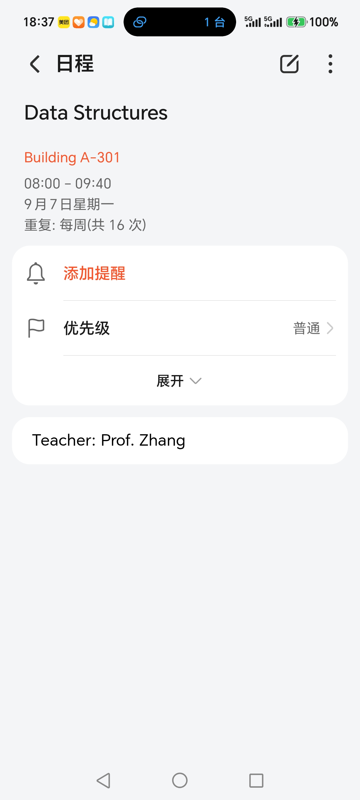

# course-to-ics · 课表转 iCalendar 日历服务

[](https://github.com/radiantcat1/course-to-ics/actions/workflows/ci.yml)

把一份结构化课表（JSON）转换成标准 `.ics` 日历文件。导入手机 / Outlook / Google 日历后，每门课会按周自动重复，不需要手动录入 16 周。

## 为什么做这个

教务系统里的课表只能查看，不能订阅；手动往日历里加课既慢又容易漏。这个服务把「学期第一周周一 + 每门课的星期/节次/周数」变成一份标准 iCalendar 文件，交给日历客户端去处理重复规则。

## 技术栈

- Java 17 / Spring Boot 3.2.1 / Maven
- Bean Validation（`jakarta.validation`）做参数校验
- Jackson 处理 JSON 与 `LocalDate`
- **无数据库、无前端、无状态**：一次请求进、一份文本出

## 快速开始

```bash
git clone https://github.com/radiantcat1/course-to-ics.git
cd course-to-ics
mvn spring-boot:run
```

服务默认监听 `8080`。健康检查：

```bash
curl http://localhost:8080/api/v1/health
# {"code":0,"message":"ok","data":"course-to-ics is running"}
```

## 接口

| 方法 | 路径 | 说明 |
|---|---|---|
| GET | `/api/v1/health` | 健康检查 |
| POST | `/api/v1/ics/preview` | 返回 `Result<String>`，`data` 是 ICS 文本，便于调试 |
| POST | `/api/v1/ics/download` | 直接下载 `timetable.ics`（`text/calendar`） |

统一响应外壳：`{"code":0,"message":"ok","data":...}`。参数不合法返回 HTTP 400 + 业务码 `40001`；节次倒挂返回 `40003`；未预期异常返回 HTTP 500 + `50001`。

## 请求示例

见仓库里的 [`sample.json`](sample.json)：

```json
{
  "semesterStart": "2026-09-07",
  "courses": [
    {
      "title": "Data Structures",
      "dayOfWeek": 1,
      "startPeriod": 1,
      "endPeriod": 2,
      "weeks": 16,
      "location": "Building A-301",
      "teacher": "Prof. Zhang"
    }
  ]
}
```

| 字段 | 含义 |
|---|---|
| `semesterStart` | 学期**第一周周一**的日期，`yyyy-MM-dd` |
| `dayOfWeek` | 1 = 周一 … 7 = 周日 |
| `startPeriod` / `endPeriod` | 第几节到第几节，1–10 |
| `weeks` | 连续上几周，1–30 |

```bash
curl -X POST http://localhost:8080/api/v1/ics/download \
  -H "Content-Type: application/json" \
  --data-binary @sample.json \
  -o timetable.ics
```

生成的片段：

```ics
BEGIN:VEVENT
UID:course-20260907-1@course2ics
DTSTAMP:20261115T101510Z
DTSTART;TZID=Asia/Shanghai:20260907T080000
DTEND;TZID=Asia/Shanghai:20260907T094000
RRULE:FREQ=WEEKLY;COUNT=16
SUMMARY:Data Structures
LOCATION:Building A-301
DESCRIPTION:Teacher: Prof. Zhang
END:VEVENT
```

## 演示



## 接口文档

启动服务后访问 <http://localhost:8080/swagger-ui/index.html>，可在页面直接填入请求体调试三个接口；机器可读的 OpenAPI JSON 在 <http://localhost:8080/v3/api-docs>。

## 设计要点

- **统一响应与全局异常**：`Result<T>` + `@RestControllerAdvice`，业务代码不写 try/catch；HTTP 状态码与业务错误码分层。
- **级联校验**：`@Valid` 加在 `List<CourseItem>` 上才会校验列表内每一门课；DTO 用 Java 17 `record` 减少样板代码。
- **节次映射配置化**：作息时间表放在两个数组常量里，换学校作息只改这两行，不写 `if/else` 链。
- **用 `RRULE` 而不是展开 N 条事件**：`FREQ=WEEKLY;COUNT=16` 让日历客户端自己重复，文件更小、改周数只动一行。
- **时区处理**：`DTSTART;TZID=Asia/Shanghai` 用本地时间 + 时区名，`DTSTAMP` 用 UTC 且带 `Z`，两者规范不同。
- **ICS 规范细节**：特殊字符（反斜杠、分号、逗号、换行）转义；按 **UTF-8 字节数** 75 字节折行、续行以一个空格开头，避免把中文切半个字；行尾统一 `\r\n`。
- **构造器注入**：`IcsController` 依赖 `IcsService` 由构造器传入，便于单元测试。
- **配置驱动**：作息时间表、时区、日历名都在 `application.yml`，通过 `@ConfigurationProperties` 绑定，换学校作息不用改代码。
- **自动化测试与 CI**：JUnit 5 参数化测试 + MockMvc 集成测试 + 配置绑定测试（17 个用例），GitHub Actions 在每次 push / PR 自动运行，README 展示构建状态。

## 目录结构

```
src/main/java/com/radiantcat1/course2ics/
├── Course2IcsApplication.java
├── common/     Result / ErrorCode / BizException / GlobalExceptionHandler
├── controller/ HealthController / IcsController
├── dto/        CourseItem / CourseRequest
└── service/    IcsService   ← ICS 生成核心
```

## Roadmap

- [ ] 随文件附带 `VTIMEZONE` 组件（目前依赖日历客户端内置 IANA 时区）
- [ ] 支持跳周 / 单双周（`RRULE` 的 `BYDAY` + `EXDATE`）
- [ ] `/parse` 接口：把教务系统复制的课表文本解析成结构化课程
- [ ] 极简网页表单，不懂 curl 也能用
- [ ] 单元测试覆盖 `esc()`、`fold()`、日期计算
